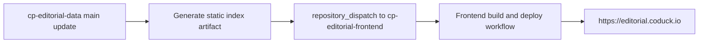

# ARCHITECTURE

## 1. Goals

`cp-editorial-frontend` is a React + Vite + TypeScript web app for searching and browsing competitive-programming editorials.

Core goals:

1. Discover editorials via search and category flows.
2. Support internationalized UI (English, Korean, Japanese initially).
3. Consume editorial metadata from `cp-editorial-data`.
4. Support Unicode editorial filenames safely.
5. Automatically deploy to `https://editorial.coduck.io` when editorial data is updated.
6. Support user-selectable light/dark theme with persisted preference.

## 2. System context



- **Data source**: `cp-editorial-data`
- **Frontend repo**: `cp-editorial-frontend`
- **Runtime consumption**: static index JSON (`/public/data/editorial-index.json` or published artifact equivalent)
- **Deployment target**: custom domain `editorial.coduck.io`

## 3. Frontend module architecture

```text
src/
  app/
    App.tsx
    providers/
    routes/
  pages/
    Home, Search, Categories, Category, EditorialDetail, Contribute
  entities/
    editorial/model/
      types.ts
      normalize.ts
  shared/
    api/
    hooks/
    i18n/
    ui/
```

### Responsibilities

- `app/`: app-level composition, providers, routing.
- `pages/`: route-level UI and feature orchestration.
- `entities/editorial/model/`: typed domain model and normalization.
- `shared/api/`: data access boundary (editorial index fetch).
- `shared/hooks/`: reusable data hooks.
- `shared/i18n/`: translations and i18n utilities.
- `shared/ui/`: layout and reusable UI components.

## 4. Data contract and normalization

The frontend consumes a static index with this shape:

```json
{
  "version": "2026.04.17",
  "generatedAt": "2026-04-17T00:00:00Z",
  "editorials": [
    {
      "contest": "중앙대학교",
      "problem": "2026 중앙대학교 프로그래밍 경진대회 (CPC)",
      "categories": ["University"],
      "path": "University/중앙대학교/2026 중앙대학교 프로그래밍 경진대회 (CPC).pdf",
      "filename": "2026 중앙대학교 프로그래밍 경진대회 (CPC).pdf",
      "title": {
        "en": "2026 중앙대학교 프로그래밍 경진대회 (CPC)",
        "ko": "2026 중앙대학교 프로그래밍 경진대회 (CPC)",
        "ja": "2026 중앙대학교 프로그래밍 경진대회 (CPC)"
      },
      "summary": {
        "en": "중앙대학교 editorial",
        "ko": "중앙대학교 해설",
        "ja": "중앙대학교 解説"
      }
    }
  ]
}
```

### Filename policy

- `filename` may use any language/script.
- Unicode filenames are accepted.

### Path mapping policy

- All directory segments before the final directory are treated as the **category hierarchy**.
- The final directory segment is treated as the **contest name / organizer**.
- File stem is treated as **contest entry title**.
- Examples:
  - `Olympiad/Russian Olympiad in Informatics/Russia Team High School Programming Contest 2020.pdf`
    - category hierarchy: `Olympiad`
    - contest: `Russian Olympiad in Informatics`
    - entry title: `Russia Team High School Programming Contest 2020`
  - `ICPC/Regionals/Latin America/Latin America Championship/The 2024 ICPC Latin America Championship.pdf`
    - category hierarchy: `ICPC > Regionals > Latin America`
    - contest: `Latin America Championship`
    - entry title: `The 2024 ICPC Latin America Championship`

### Exclusion policy

- Index generation supports explicit excludes via `scripts/editorial-index.config.json`:
  - `excludeFileNames`
  - `excludePathPrefixes`
  - `excludePathPatterns`
- Current defaults exclude repository-management content such as `README.md`, `LICENSE`, and the `.github/` folder.

### Stable ID policy

- Routing must not depend on filename language.
- Editorial IDs are derived from stable fields (`contest`, `problem`, `path`) when explicit `id` is not provided.
- Runtime normalization and route-preview generation share `src/entities/editorial/model/editorialId.mjs`. It trims each field, joins them with `::`, lowercases the result, and hashes UTF-16 code units to preserve existing runtime IDs, including supplementary CJK characters and emoji.
- Explicit non-empty IDs are trimmed and preserved. Changing a source field can change a derived ID; retain an explicit ID when renaming a file must preserve its route.

### Validation policy

Normalization rejects invalid index data (missing required fields or empty localized title content) with explicit errors.

### Loading and freshness policy

- The editorial repository shares one in-flight request and keeps the successfully normalized index in memory for the lifetime of the page.
- All `useEditorialIndex` consumers reuse that request; newly mounted consumers start with cached data without an index loading state after a successful load.
- Failed network, HTTP, JSON, or normalization attempts are not cached. Errors remain visible, and navigating to another data page or reloading retries the load.
- The first request uses `cache: 'no-cache'` to revalidate any browser HTTP cache. SPA navigation keeps the same index snapshot; a full reload or new tab checks for updated deployment data. There is no background polling or persistent application cache.

## 5. Routing model

| Route                           | Purpose                                                         |
| ------------------------------- | --------------------------------------------------------------- |
| `/`                             | Home summary, index stats, and “What is CP Editorial?” article  |
| `/search`                       | Empty-search summaries, then keyword results grouped by contest |
| `/categories`                   | Category listing                                                |
| `/categories/*`                 | Hierarchical browse pages for each directory level              |
| `/editorials/:editorialId`      | Editorial detail page                                           |
| `/editorials/:editorialId/view` | PDF preview or direct source opening for non-PDF content        |
| `/contribute`                   | Upload/contribution guide for `cp-editorial-data`               |
| `/copyright`                    | Ownership, attribution, and usage guidance                      |

Category browsing is path-hierarchy driven, so nested folders like `ICPC/Regionals/Asia Pacific/Asia Pacific Championship` are navigable at each level.

The editorial viewer checks the source path's extension case-insensitively. PDFs retain the full-response ArrayBuffer → PDF Blob → object URL preview, with a 15-second timeout covering both the request and body download. Timeout guidance is distinct from other errors in all UI locales. Retry starts a fresh attempt without reloading the app. Results belong to a source path and attempt; aborted requests cannot create object URLs or update the result. Each attempt clears its timer on completion or cleanup, aborts on retry/navigation, and revokes its object URL on cleanup. Non-PDF sources (including the supported Markdown and text formats) are never fetched or embedded by the viewer; they offer an encoded raw-source link in a new tab with `rel="noreferrer"`. Download and return/navigation actions remain available. No rich text renderer or progressive PDF loading is used.

Search conditions are stored in the `q`, `category`, and `year` URL parameters. Controls update optimistically during router transitions, then use the committed URL values. No effect copies an earlier URL query over newer input. Edits replace the current history entry; opening an editorial preserves that search entry for Back. Clear removes all three search parameters while retaining unrelated parameters. Empty or unknown category/year values display the unfiltered default; valid filters are resolved once the editorial index finishes loading.

Search splits the query on whitespace, lowercases and deduplicates tokens, and requires every token to occur in at least one visible title, contest, entry, category, summary, or filename field. Category and year filters apply alongside token matching. A full title or contest containing exactly the same distinct tokens ranks first, regardless of token order, whitespace, or case. Other results sum each token's strongest title/contest match: exact field (3), whole word (2), substring (1), or other metadata only (0). Whole-word boundaries respect Unicode letters, numbers, combining marks, and underscores. Editorials sort by total score within each contest; contest groups sort by their best editorial. Ties retain the existing category/contest and filename order. Empty queries retain summaries or filter-only results. Match context is deduplicated against the displayed localized title and earlier matching fields after lowercasing, trimming, and collapsing whitespace. A filename whose stem repeats displayed text is omitted unless its extension explains a query token absent from the stem. The highlighter returns both plain snippet text and highlighted content from the same bounds. Context also deduplicates this text after truncation when the fields match the same query tokens, and reuses the highlighted content for rendering. Requiring the same matched tokens preserves literal punctuation matches that might otherwise look like generated ellipses. Distinct visible snippets retain their localized labels; category/year context remains visible. This presentation-only selection does not affect matching or ranking. Literal token highlights use the same lowercase comparison as search. Overlapping matches are merged, and lowercase offsets are mapped back to the original characters so Unicode expansions do not shift highlights. Snippets expand when necessary to keep distant matches visible.

## 6. Internationalization

- Framework: `i18next` + `react-i18next`
- Locales: `en`, `ko`, `ja`
- UI language is switchable at runtime.
- Editorial localized fields are resolved with fallback order:
  1. active locale
  2. `en`
  3. `ko`
  4. `ja`
  5. first available value

## 7. UI preferences

### Presentation foundation

`src/app/styles.css` applies Fluent 2 web guidance to the existing components without a new UI dependency. Semantic tokens cover canvas/surfaces, text, brand actions, borders, feedback, focus, spacing (4px base), typography, radii and elevation. Both themes use the same token roles. Rem-based typography uses local Segoe/system fonts with Korean and Japanese fallbacks; no runtime fonts are added. Titles and metadata wrap rather than being clipped. Search keeps full editorial titles while the existing context-snippet bounds and highlighting logic remain in use.

Native links, buttons, inputs and selects retain their browser semantics. Shared focus-visible outlines, hover/pressed states and reduced-motion handling apply throughout. Selected navigation combines color with an underline and `aria-current`. The header stays in document flow so expanded menus and zoomed text cannot cover the reading area. At narrow widths navigation uses a disclosure (not an ARIA application menu); Escape and link activation return focus to its trigger, while Tab leaving navigation closes the disclosure without stealing focus. A skip link targets the focusable main landmark.

`PageState` is shared by index loading/failure and missing-record routes. Failures retain diagnostic text, add localized recovery instructions and offer a full-page reload to retry the existing index loader. Search result counts and empty results use status announcements; PDF recovery keeps the existing alert, Retry, Download and return actions. These presentation changes do not change caching or PDF request lifecycles.

`tests/design.spec.ts` covers keyboard navigation, preference persistence, loading recovery, theme contrast and overflow at 320/768/1280 CSS pixels with normal and 200% root text sizing in all three locales. See `docs/design/fluent-2/README.md` for the proposal, screenshots and manual validation boundaries.

- Theme supports `light` and `dark`.
- Active theme is selected in the header and persisted in browser local storage.
- Theme is applied at the document root via `data-theme`, so all routed pages share one consistent palette.
- Open Graph/Twitter metadata still has static defaults in `index.html` and `public/404.html`.
- Build now generates route HTML pages with crawlable metadata for `/search`, `/categories` + hierarchy sub-routes, `/contribute`, `/copyright`, and `/editorials/:editorialId`.
- `search/categories/contribute/copyright` share one preview image; editorial detail routes use generated per-editorial preview PNG images.
- Editorial PNGs keep their existing URLs and 1200 × 630 dimensions. Pretendard remains the primary font; Han ideographs and recognized emoji sequences use separate SVG text chunks with bundled Source Han Sans (Regular/Bold) and monochrome Noto Emoji. This avoids Resvg's fallback limitation when emoji shaping changes the glyph count, and preserves Pretendard for surrounding Korean/Latin text. Truncation keeps grapheme clusters intact. System fonts stay disabled, and the CJK fallback uses Japanese default glyph forms. Fonts are build inputs, not public webfont assets. Then `sharp` quantizes the pixels to a 256-colour PNG palette.
- `.cache/route-previews` stores images outside Vite's cleared output directory. SHA-256 keys include normalized editorial metadata, the generator (including its SVG template and encoding settings), every font in the renderer's font-file list, the background image, `package-lock.json`, and the Node.js version/platform/architecture. Complete PNGs are atomically renamed into the cache. Missing entries are rendered; other filesystem errors fail the build. Route HTML is always regenerated, and all current images are written into `dist`, even on a full cache hit. The cache is disposable; older entries remain until it is cleared.
- `public/404.html` remains the fallback path-restoration mechanism for unknown/non-generated routes.

## 8. Upload guidance flow

The website includes a dedicated `/contribute` page with instructions:

1. Add files in `Category hierarchy/Contest(or Organization)/Editorial file` hierarchy.
2. Use clear filenames because the filename stem becomes the displayed editorial entry title.
3. Keep only editorial source files in target folders (non-editorial files are excluded by config).
4. Merge PR to `main` to trigger index regeneration + frontend deployment.

## 9. CI quality architecture

`ci.yml` enforces:

1. Formatting check (`npm run format:check`)
2. Lint (`npm run lint`)
3. Static analysis/type-check (`npm run analyze`)
4. Build (`npm run build`)
5. Chromium browser regression tests (`npm test`, after installing the Playwright browser)

Runs on pull requests and pushes to `main`.

CI and deployment cache `.cache/route-previews` with `actions/cache`. The archive key covers the render inputs and editorial index; the restore prefix omits the index so data updates can reuse unchanged editorial images. Deployment restores after index generation so `repository_dispatch` builds use the new data in their archive key. The generator independently validates each image's input hash before reuse.

`sonarcloud.yml` adds code-quality scanning on pull requests and pushes to `main`:

1. Validates SonarCloud repository configuration (`SONAR_TOKEN`, `SONAR_ORGANIZATION`, `SONAR_PROJECT_KEY`)
2. Runs SonarCloud scan with repository-level settings from `sonar-project.properties`
3. Enforces merge-blocking quality gate status through the SonarCloud quality gate action

Dependabot PRs are also validated by the CI workflow, and dependency updates are managed via `.github/dependabot.yml`.

## 10. Deployment architecture

### Trigger policy

- Frontend deploy runs on:
  - push to `main` in `cp-editorial-frontend`
  - `repository_dispatch` event from `cp-editorial-data` updates
  - manual `workflow_dispatch`

### Deployment target

- GitHub Pages deployment with custom domain:
  - `public/CNAME` contains `editorial.coduck.io`
  - deployment serves `https://editorial.coduck.io`

### Update behavior

On `cp-editorial-data` main updates:

1. Data repo sends dispatch event to frontend repo.
2. Frontend runs `npm run index:generate` to fetch full file tree from `cp-editorial-data` and regenerate static index.
3. Frontend rebuilds with latest index.
4. Updated site is published to `https://editorial.coduck.io`.

## 11. Future extensions

- Incremental index partitions for very large editorial sets.
- Full-text search index generation in data pipeline.
- Runtime stale-while-revalidate index refresh strategy.
- Additional locale packs and translated metadata quality checks.
